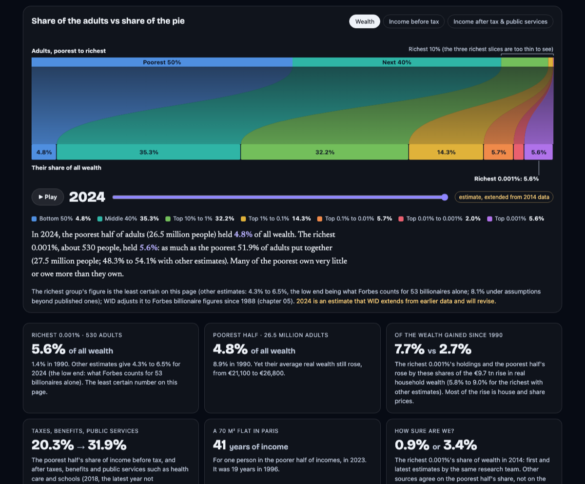

# Show Me Your Pie

**Who holds France's wealth and income, slice by slice of the population,
from 1900 to today, and how sure can we be?**

- **The app (for everyone):** <https://zboule.github.io/show-me-your-pie/>
- **The working paper (for reviewers):** [paper/paper.md](paper/paper.md)
- **The reviews and our responses:** [docs/reviews/](docs/reviews/)

Version 0.4. Open data, open code, open review (so far by AI reviewer agents;
human reviewers are invited): every number can be rebuilt
from the original sources, every hand-entered value has its source, and
every number quoted in the paper is checked against the data by the tests.
Comments are welcome as issues ([CONTRIBUTING.md](CONTRIBUTING.md)).



## What it shows

- **Who holds the pie**: share of income or wealth held by seven
  non-overlapping layers of the adult population (bottom 50%, middle 40%,
  top 10–1%, top 1–0.1%, top 0.1–0.01%, top 0.01–0.001%, top 0.001%), 1900–2024.
- **How each slice changed**: each layer's change in real holdings, split
  into the effect of the whole pie growing and the effect of its share
  moving; the share of total growth each layer received; a check of how much
  the start year drives the result.
- **Real levels** per layer, and growth along 127 percentile groups.
- **How sure we are about the very top**: WID's Forbes calibration, rich
  lists (Challenges, Forbes), scenarios in both directions (ECB / Banque de
  France lower, rich list higher), two WID-team estimates of the same year.
- **The very top of income**: WID vs IPP's firm-to-owner estimates (2016).
- **Do other sources agree?**: WID against the ECB / Banque de France
  distributional wealth accounts and INSEE's income survey, wealth survey and
  distributed national accounts.
- **Real estate and fixed costs**: years of disposable income and yearly
  repayment for a 70 m² flat, in Paris and elsewhere; income committed in
  advance; housing in each group's assets.

Three measures: net wealth, income before tax, and income after tax and
public services (health, education and collective spending counted as
income received).

## Documentation

| Doc | Content |
|---|---|
| [docs/01-concepts.md](docs/01-concepts.md) | What "rich" means: income, consumption, wealth; the income ladder; units; percentiles; the very top; time |
| [docs/02-data-france.md](docs/02-data-france.md) | Every French data source, what it can say, whether we use it and why |
| [docs/03-method.md](docs/03-method.md) | Formulas for every number, choices made, breaks, tests, planned extensions |
| [docs/04-restricted-data-plan.md](docs/04-restricted-data-plan.md) | How to go further with administrative microdata (CASD): datasets, procedure, costs, partners |
| [docs/notes/rich-lists.md](docs/notes/rich-lists.md) | Rich lists and how the top tail is estimated |
| [docs/notes/dwa.md](docs/notes/dwa.md) | ECB / Banque de France distributional wealth accounts vs WID |
| [docs/notes/insee.md](docs/notes/insee.md) | INSEE income survey, wealth survey and distributed national accounts vs WID |
| [docs/notes/prices-housing.md](docs/notes/prices-housing.md) | Price indices by income group, pre-committed spending, housing price levels |
| [docs/references.md](docs/references.md) | Bibliography with links |
| [docs/reviews/](docs/reviews/) | Two rounds of adversarial reviews by AI agents, and the responses ([README](docs/reviews/README.md)) |

## Run it

Python ≥ 3.9, standard library only. About 75 MB of downloads go to
`data/raw/` (the WID file is 69 MB uncompressed; the DVF step streams
~280 MB and keeps ~1 MB).

```bash
python3 -I pipeline/fetch.py data/raw                       # downloads; fails loudly if a source fails
python3 -I pipeline/build_data.py data/raw site/data/france.json
python3 -I pipeline/paper_numbers.py site/data/france.json paper/numbers.json
python3 -m unittest discover -s pipeline/tests              # needs the built JSON
python3 -m http.server -d site 8000                         # open http://localhost:8000
```

Opening `site/index.html` directly from disk does not work (the browser
blocks loading the data file); serve the folder as above. Deep links:
`#ptinc`, `#diinc`, `#hweal~no_cut~smooth3`, `#ptinc~cpi`.

## Layout

```
pipeline/     fetch.py (download), build_data.py (compute), top_tail.py (scenarios)
              sources/ (dwa, insee, prices, housing, rates), tests/
data/raw/     downloaded files, not versioned
data/manual/  hand-compiled tables (rich lists, IPP, surveys), one source per row
site/         index.html + data/france.json (the built dataset)
docs/         concepts, data, method, restricted-data plan, notes, references, reviews
```

## Sources

- WID.world, France: distributional national accounts (Garbinti,
  Goupille-Lebret & Piketty 2018, 2021; Fisher-Post & Gethin 2023; WIL
  Technical Note 2025/01).
- INSEE: ERFS income survey, Histoire de vie et Patrimoine wealth survey,
  distributed national accounts, consumer price indices, house price indices,
  national accounts (pre-committed spending), spatial price comparison.
- ECB / Banque de France: distributional wealth accounts; MFI mortgage rates.
- DGFiP / Etalab: DVF property transactions (aggregated statistics).
- IPP (Bach, Bozio, Guillouzouic & Malgouyres): top incomes and taxes, 2016.
- DREES and France Stratégie: pre-committed spending by income group.
- Challenges "500 plus grandes fortunes de France" and Forbes World's
  Billionaires: totals quoted in published articles.

Every hand-entered value has its source URL in `data/manual/`.

## Data provenance and licences

Raw downloads are not redistributed; `pipeline/fetch.py` gets them from the
producers. Rich-list figures (Challenges, Forbes) are totals quoted in
published articles, with the source URL and the exact quote for each year;
no data were scraped. Earlier, unpublished versions used tables whose terms
do not allow redistribution (Forbes API data, an Observatoire des inégalités
table, a Paris Notaires table). Those tables are not in this repository; the
round-1 review reports, kept as written for transparency, quote some figures
from them. See [DATA_LICENSES.md](DATA_LICENSES.md).

## Repository map, read like a paper

| Part | Where |
|---|---|
| Abstract, results, robustness, limitations | [paper/paper.md](paper/paper.md) |
| Every quoted number, generated from the data | [paper/numbers.md](paper/numbers.md) |
| Concepts and literature | [docs/01-concepts.md](docs/01-concepts.md) |
| Data sources and why each is used | [docs/02-data-france.md](docs/02-data-france.md) |
| Methods, formulas, breaks, tests | [docs/03-method.md](docs/03-method.md) |
| Going further with administrative microdata | [docs/04-restricted-data-plan.md](docs/04-restricted-data-plan.md) |
| Notes on each cross-check source | [docs/notes/](docs/notes/) |
| Review: two rounds by AI reviewer agents (not peer review), responses | [docs/reviews/](docs/reviews/) |
| Code | [pipeline/](pipeline/) (build), [site/](site/) (app) |
| Licences and attribution | [LICENSE](LICENSE) (code, MIT), [LICENSE-DOCS.md](LICENSE-DOCS.md) (text, CC BY 4.0), [DATA_LICENSES.md](DATA_LICENSES.md) (data) |
| How to cite | [CITATION.cff](CITATION.cff) |

## AI assistance

Data collection, code, documentation and the review rounds were carried out
with Claude (Anthropic) under the maintainer's direction. That is why the
reviews were made independent and adversarial, and why every figure is
reproducible and sourced.
